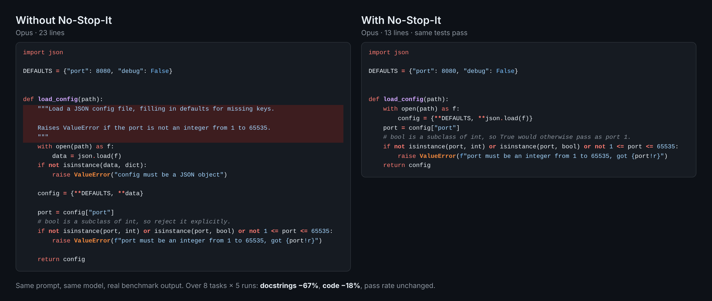

<h1 align="center">No-Stop-It</h1>

<p align="center"><em>"No. Stop it." Rules that keep your coding agent from writing code that reads like AI code.</em></p>

<p align="center">
  
  
  
</p>

<p align="center"></p>

<p align="center"><sub>Inspired by <a href="https://github.com/DietrichGebert/ponytail">Ponytail</a>.</sub></p>

<br>

## What it stops

AI code is easy to spot, and tiresome to review, because of a handful of habits:

- Comments that read the code aloud.
- Args/Returns blocks on a two-line function.
- Emoji in log lines and headings.
- A `try` that only logs.
- A fallback that returns `0` and hides the bug.
- `parse_old` left next to `parse`.
- A `SUMMARY.md` nobody asked for.
- A test whose only assertion is that the mock was called.
- A README that still names the flag the change deleted.
- "Thoroughly tested" in a PR description.

No-Stop-It gives your agent one rule for each. Every rule is **a sign you can observe → what to write instead**, so the agent knows exactly when it applies and has a replacement, not only a ban.

<br>

## The rules

The code skill, `no-stop-it`, has 15 rules in six groups:

| Group | Stops |
|-------|-------|
| **Comments and docs** | narrating comments, boilerplate docstrings, comments about the edit itself or the ticket behind it, summary files, emoji |
| **Errors** | `try` that only logs, silent fallbacks, checks on values that cannot be missing |
| **Leftovers** | debug prints, `_old` / `_v2` copies, commented-out code, TODOs with no reason |
| **Names** | names longer than four words, or placeholders like `data` and `helper` |
| **Tests** | tests that assert on a mock, or compute the expected value with the code under test |
| **The diff** | stale mentions of a renamed or removed name, a version changed in one copy, refactors mixed into a behavior change, diffs past about 400 lines |

The codebase's own style always comes first. A closing "never stop" list keeps the comments, docs and error handling that matter: why a workaround exists, public API docs the project requires, handling at trust boundaries.

Read the full list: [`skills/no-stop-it/SKILL.md`](skills/no-stop-it/SKILL.md).

### Writing to people

A second skill, `no-stop-it-writing`, does the same for what the agent writes to a person: commit messages, PR descriptions, review replies, ticket comments, design docs, slides and chat replies. 18 rules in five groups, each taken from a correction a user made to agent output:

| Group | Stops |
|-------|-------|
| **Length and shape** | paragraph commit messages and PR descriptions, dense blocks that are hard to follow, tables with columns only the code can explain, "Caveats" sections, reasoning when a yes/no or a list was asked for |
| **Audience** | function names and line numbers in text for non-engineers, replies to reviewers that argue, "generic" drafts that still carry the current example; documents with sections hand off to the three document skills below |
| **Substance** | findings that name the symptom instead of the mechanism, option comparisons that are deep dives instead of cost, risk and time per option, descriptions that claim what the diff does not contain, a reading of an ambiguous request taken silently |
| **Before you claim** | "thoroughly tested" instead of the acts performed, inferred facts written as facts, links built from a name, load-bearing or relayed claims that were never checked |
| **Hands off the send button** | publishing, posting or sending anything on the user's behalf; posting somewhere other than where the user said |

Read the full list: [`skills/no-stop-it-writing/SKILL.md`](skills/no-stop-it-writing/SKILL.md). The benchmark has three writing tasks for it, not yet run.

### Documents and design docs

Three on-demand skills for documents a team reads and keeps. They load when the agent drafts or edits a document with sections, not on every turn.

| Skill | Covers |
|-------|--------|
| [`no-stop-it-docs`](skills/no-stop-it-docs/SKILL.md) | any document: what goes in the body, an appendix or your own notes; tables for numbers and paragraphs for reasoning; sweeping cross-references and stale numbers after an edit; following the team's template and the previous doc; not doubling a doc during review |
| [`no-stop-it-hld`](skills/no-stop-it-hld/SKILL.md) | the high-level design: a decision document for people who must agree to the approach. Sections with a "done when" for each, decisions as one question per choice point with lettered options and a verdict, cons that name the thing that kills an option, the north star, what takes the system down, estimates with how they were made |
| [`no-stop-it-lld`](skills/no-stop-it-lld/SKILL.md) | the low-level design: how each chosen component does its job, for the engineers who build and review it. One annotated sample item instead of a schema table, gates in code order on the sequence diagram, timeout and miss behavior per call, capacity arithmetic shown once, no file lists |

The boundary between the two, from `no-stop-it-hld`: ask of every sentence which pieces it touches. Several, or the choice between them, is the HLD; the inside of one is the LLD. Deleting an HLD sentence would change which option a reviewer picks; deleting an LLD sentence would change what an engineer types. The line moves with scale, so each skill says when one doc with two sections is enough and when to split.

<br>

## Install

### Claude Code

Send these as two separate prompts:

```
/plugin marketplace add HQingXuan/No-Stop-It
```

```
/plugin install no-stop-it@no-stop-it
```

### Cursor

```
mkdir -p .cursor/rules && curl -fsSL https://raw.githubusercontent.com/HQingXuan/No-Stop-It/main/.cursor/rules/no-stop-it.mdc -o .cursor/rules/no-stop-it.mdc
```

### Kiro

```
mkdir -p .kiro/steering && curl -fsSL https://raw.githubusercontent.com/HQingXuan/No-Stop-It/main/.kiro/steering/no-stop-it.md -o .kiro/steering/no-stop-it.md
```

### Codex, Windsurf, Cline, opencode, Devin, and any agent that reads `AGENTS.md`

```
curl -fsSL https://raw.githubusercontent.com/HQingXuan/No-Stop-It/main/AGENTS.md >> AGENTS.md
```

### GitHub Copilot

```
mkdir -p .github && curl -fsSL https://raw.githubusercontent.com/HQingXuan/No-Stop-It/main/.github/copilot-instructions.md >> .github/copilot-instructions.md
```

### Gemini CLI

```
gemini extensions install https://github.com/HQingXuan/No-Stop-It
```

### DeepSeek, Qwen, Kimi, or any other model

No-Stop-It is plain text, so it works with any model. Run the model in one of the agents above, or put [`AGENTS.md`](AGENTS.md) in its system prompt.

All of these are copies of the same two always-on skills, kept in sync by `python scripts/sync_rules.py`.

### The document skills

`no-stop-it-docs`, `no-stop-it-hld` and `no-stop-it-lld` are not in the always-on copies; they are meant to load when a document is being written. The Claude Code plugin ships them. For Kiro, install them as skills:

```
for s in no-stop-it-docs no-stop-it-hld no-stop-it-lld; do mkdir -p ~/.kiro/skills/$s && curl -fsSL https://raw.githubusercontent.com/HQingXuan/No-Stop-It/main/skills/$s/SKILL.md -o ~/.kiro/skills/$s/SKILL.md; done
```

For any other agent, paste the relevant `SKILL.md` into the conversation when you start a doc.

<br>

## Benchmark

### Results

8 coding tasks, 5 runs each, with and without the rules (the three writing tasks below were added later and have no results yet):

| Setup | Docstrings | Narrating comments | Added lines |
|---|---|---|---|
| Sonnet | 14 → 5 | 3 → 1 | 822 → 707 |
| Sonnet, one-line system prompt | 13 → 3 | 0 → 0 | 807 → 706 |
| Opus | 15 → 5 | 0 → 0 | 1055 → 864 |

- Pass rate and judged completeness were the same in every setup. One task, `ctl-csv`, failed in both arms for Sonnet with Claude Code's prompt.
- Opus wrote 6 comments in both arms, all of them "why" comments, which the rules keep.
- Emoji, broad `except`, leftovers and new `.md` files were 0 in both arms on these tasks.

### What it measures

Each task runs in a fresh repo as a headless `claude -p` session. For every run, the benchmark:

1. Counts the style habits in the diff: narrating comments, docstrings, emoji, broad `except`, leftovers, new `.md` files. For the three writing tasks (`wr-`): paragraphs of 40 words or more, adverb claims ("thoroughly tested"), caveat headings, and words.
2. Checks that the task works, including a probe that a missing file or a broken database raises instead of falling back silently. The writing tasks check facts instead: the PR description does not claim the `--json` flag the patch subject lies about, the ticket update names the dropped index and the next migration without saying the fix landed, the reviewer reply answers from the code instead of agreeing with the reviewer's wrong guess.
3. Asks a blind judge how much of the task was delivered, 0 to 3, so rules that make the agent do less would show up.

The summary reports, per task group, on how many tasks the rules beat the baseline (sign test) and by how much (95% bootstrap CI).

### Run it

`run.py` starts each session with an empty `HOME`, so sign in through `ANTHROPIC_API_KEY` or `CLAUDE_CODE_OAUTH_TOKEN` in the environment.

```
python benchmarks/score.py --selftest
python benchmarks/judge.py --selftest
python benchmarks/run.py --runs 5                        # every task, both arms
python benchmarks/run.py --runs 5 --model opus --bare    # another model, a one-line system prompt
python benchmarks/run.py --runs 5 --tasks wr-pr-description wr-ticket-update wr-review-reply   # the writing tasks only
```

Results land in `benchmarks/results/<time>/summary.md`. The summaries already there come from the scorer at commit `72aa3c0`, which named the rules arm `style` and reported extra columns.

<br>

## Why the rules look like this

- **Every rule names its replacement.** [superpowers](https://github.com/obra/superpowers) found that bare prohibitions backfire on output shape: "don't narrate" produced more narration.
- **Every rule has an observable sign.** "Your comment says what the next line does", not "don't over-comment".
- **The codebase's style wins.** Said once at the top, instead of "unless" clauses on every rule.
- **A "never stop" list.** So "fewer comments" never turns into "no why".

The habits come from [deslop](https://github.com/dabit3/deslop), [beagle](https://skills.cat/skills/existential-birds/beagle/llm-artifacts-detection), and user complaints about [emoji in headings](https://claudeissues.com/issue/3567-markdown-header-emoji-removal-prevent-emoji-in-documentation-sections), [unrequested .md files](https://forum.cursor.com/t/claude-models-with-cursor-constantly-wastefully-generate-md-docs-files-violating-rules/147673) and [silent fallbacks](https://hyperdev.matsuoka.com/p/bad-habit-of-agentic-coders-part). The test, diff and claim rules come from what reviewers report: [a study of 1,154 developer posts on AI slop](https://arxiv.org/abs/2603.27249), [a survey of 10,000 CLAUDE.md files](https://wonderingaboutai.substack.com/p/i-analyzed-10000-claudemd-files-to), and [deslop 2](https://github.com/agent-sh/deslop)'s finding that current models leave stale mentions of what they renamed, not debug prints.

An earlier version of No-Stop-It was an engineering stop list (retry loops, polling, bending tests). Its benchmark showed current models already avoid most of those moves, so this one replaced it. It is still in the git history.

The document skills take their section lists and the HLD/LLD split from [Design Docs at Google](https://www.industrialempathy.com/posts/design-docs-at-google/) (context and scope, goals and non-goals, alternatives as the most important section, sketch APIs and schemas instead of pasting them, and its warning that a design doc which is only an implementation manual did not need writing), the [C4 model](https://c4model.com/diagrams)'s four zoom levels, which the skills map onto the HLD (context, container) and the LLD (component, dynamic), [a boundary article](https://www.codingshuttle.com/low-level-system-design-lld-handbook/high-level-vs-low-level-design-drawing-the-boundary/) whose one test is "which of my pieces does it touch", several internal design templates and a senior engineer's design-review checklist from the author's workplace, and the author's own design reviews, where the corrections were: keep schema and observability but drop package and class lists, paragraphs unless a table is asked for, options as pros and cons with a verdict, diagrams at the component level in the team's style, and sweep the doc after every edit.

<br>

## License

MIT
