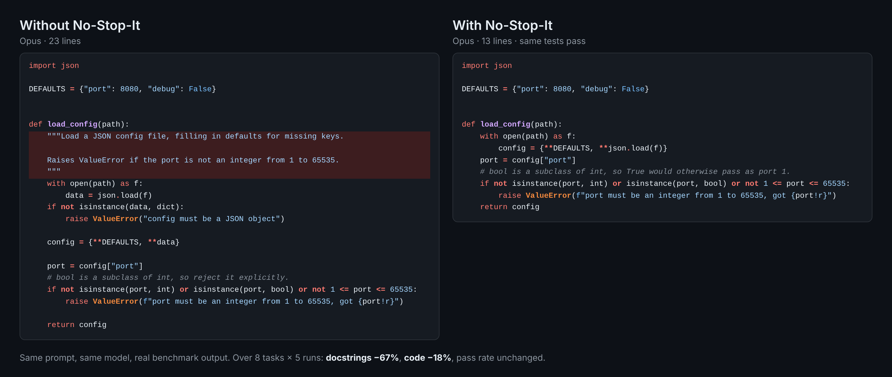

<h1 align="center">No-Stop-It</h1>

<p align="center"><em>"No. Stop it." Rules that keep your coding agent from writing code that reads like AI code.</em></p>

<p align="center">
  
  
  
</p>

<p align="center"></p>

[Ponytail](https://github.com/DietrichGebert/ponytail) tells your agent what to build: the smallest change that works. No-Stop-It tells it how **not** to write it: the habits that make AI code easy to spot and tiresome to review. Comments that read the code aloud. Args/Returns blocks on a two-line function. Emoji in log lines. A `try` that only logs. A fallback that returns `0` and hides the bug. `parse_old` left next to `parse`. A `SUMMARY.md` nobody asked for.

Each rule is written as **a sign you can observe → what to write instead**, so the agent knows exactly when it applies and has a replacement, not only a ban.

## Skill

`no-stop-it`: 11 rules in four groups (comments and docs, errors, leftovers, names), a rationalization table, and a "never stop" list of comments, docs and error handling the rules must not cut. The codebase's own style comes first.

## Install

**Claude Code** (send these as two separate prompts):

```
/plugin marketplace add HQingXuan/No-Stop-It
/plugin install no-stop-it@no-stop-it
```

**Cursor:** add the rule to your project.

```
mkdir -p .cursor/rules && curl -fsSL https://raw.githubusercontent.com/HQingXuan/No-Stop-It/main/.cursor/rules/no-stop-it.mdc -o .cursor/rules/no-stop-it.mdc
```

**Codex, and any agent that reads `AGENTS.md`:** append the rules to yours.

```
curl -fsSL https://raw.githubusercontent.com/HQingXuan/No-Stop-It/main/AGENTS.md >> AGENTS.md
```

**GitHub Copilot:**

```
mkdir -p .github && curl -fsSL https://raw.githubusercontent.com/HQingXuan/No-Stop-It/main/.github/copilot-instructions.md >> .github/copilot-instructions.md
```

**Gemini CLI:**

```
gemini extensions install https://github.com/HQingXuan/No-Stop-It
```

All of these are copies of [`skills/no-stop-it/SKILL.md`](skills/no-stop-it/SKILL.md), kept in sync by `python scripts/sync_rules.py`.

## Benchmark

`benchmarks/` runs plain coding tasks in fresh repos, each as a headless `claude -p` session, with and without the rules (appended to the system prompt). For every cell it counts the style habits in the diff (narrating comments, docstrings, emoji, broad `except`, `_old`/`TODO` leftovers, new `.md` files) and runs a check that the task works, including a probe that a missing file or broken database raises instead of falling back silently. A blind judge scores how much of each task was delivered, 0-3, so rules that make the agent deliver less show up.

```
python benchmarks/score.py --selftest      # check the scorers, free
python benchmarks/judge.py --selftest      # check the judge, a few cents
python benchmarks/run.py --runs 5          # every task, both arms
python benchmarks/run.py --runs 5 --model opus --bare   # another model, a one-line system prompt
```

Results land in `benchmarks/results/<time>/summary.md`: per task group, on how many tasks the rules beat the baseline (sign test) and by how much (95% bootstrap CI over tasks).

8 tasks, 5 runs per arm:

| setup | docstrings | narrating comments | added lines | cost |
|---|---|---|---|---|
| Sonnet, baseline → rules | 14 → 5 | 3 → 1 | 822 → 707 | +11% |
| Sonnet, one-line prompt | 13 → 3 | 0 → 0 | 807 → 706 | +3% |
| Opus, baseline → rules | 15 → 5 | 0 → 0 (6 "why" comments both) | 1055 → 864 | +8% |

Pass rate and judged completeness were the same in every setup. Emoji, broad `except`, leftovers and new `.md` files were 0 in both arms on these tasks.

An earlier version of No-Stop-It was an engineering stop list (retry loops, polling, bending tests). Its benchmark found current models already avoid most of those moves, so it was replaced by this one; it is in the git history.

## Why the rules look like this

- **[Ponytail](https://github.com/DietrichGebert/ponytail):** a ranked ladder of positive choices plus a short "never cut" list. Short, plain words, one file.
- **[superpowers](https://github.com/obra/superpowers):** found in wording tests that bare prohibitions backfire on *output shape* ("don't narrate" produced more narration). So every rule here names its replacement.
- **[deslop](https://github.com/dabit3/deslop)**, **[beagle](https://skills.cat/skills/existential-birds/beagle/llm-artifacts-detection)** and user complaints ([emoji in headings](https://claudeissues.com/issue/3567-markdown-header-emoji-removal-prevent-emoji-in-documentation-sections), [unrequested .md files](https://forum.cursor.com/t/claude-models-with-cursor-constantly-wastefully-generate-md-docs-files-violating-rules/147673), [silent fallbacks](https://hyperdev.matsuoka.com/p/bad-habit-of-agentic-coders-part)): where the habits come from.

So No-Stop-It:

1. Puts an observable sign on every rule ("your comment says what the next line does"), not a judgment call ("don't over-comment").
2. Pairs every sign with what to write instead.
3. Lets the codebase's existing style win, stated once at the top instead of as "unless" clauses.
4. Ends with what the rules must never cut, so "fewer comments" never turns into "no why".

## License

MIT
